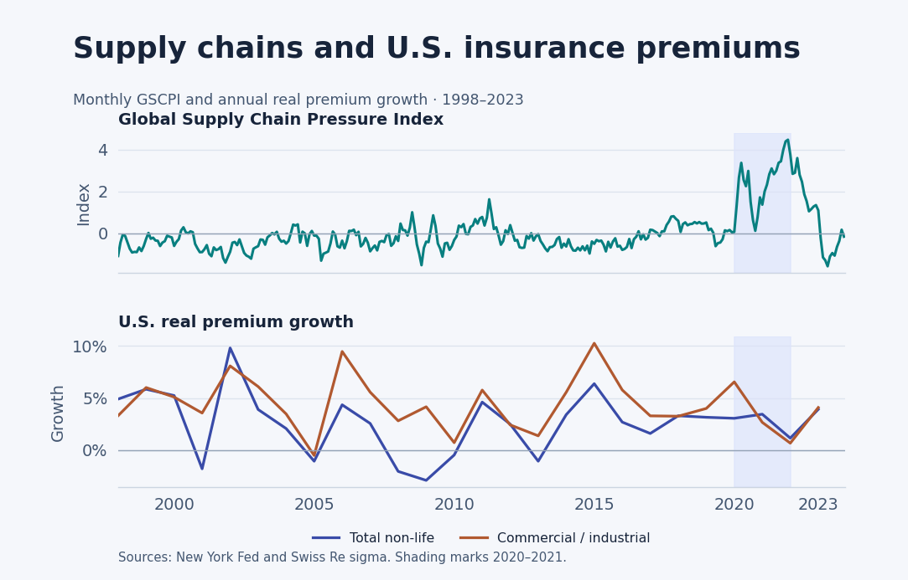

# Supply Chain Stress & U.S. Insurance Premiums

Do global supply chain disruptions show up in what U.S. businesses pay for non-life insurance? This empirical study compares shipping stress, manufacturing sector indicators, and real premium growth for the total market and commercial/industrial lines.



[Research report](IEOR4572_FinalProjectReport.pdf) · [Event-study plots](Plots/premium_abnormal_smedex.png) · [VAR notebook](notebook4.ipynb)

## Findings

- Global stress indices capture recognizable disruption periods. The chart highlights 2020–2021, when the New York Fed index rose sharply.
- Annual premium responses differed across events and business lines. The saved multivariable regression for total non-life premiums used **9 observations** and had an overall **p-value of 0.65**.
- In the saved annual VAR, the estimated response of total non-life premium growth to a one-unit GSCPI innovation was **−0.29 percentage points after one year**, then diminished. The estimated effects were small and statistically uncertain.

Aggregate premiums are an imperfect measure of underlying risk because they also reflect pricing, coverage, and exposure. The analysis relies on observational market data and a short overlapping annual sample.

## Research workflow

| Notebook | What it covers |
| --- | --- |
| [01 · Explore the data](notebook1.ipynb) | Read the stress indices and inspect the Swiss Re insurance series. |
| [02 · Fit annual regressions](notebook2.ipynb) | Align monthly indicators with annual premiums and inspect OLS estimates. |
| [03 · Compare disruptions](notebook3.ipynb) | Visualize stress around major events and examine sector-return correlations. |
| [04 · Estimate dynamic responses](notebook4.ipynb) | Compare event windows for STOT and SMEDEX and estimate an annual bivariate VAR. |

## Reproduce the analysis

Run from the repository root. The notebooks read the included input snapshots from [Data/](Data/).

```bash
python -m venv .venv
source .venv/bin/activate
python -m pip install -r requirements.txt
jupyter lab
```

The raw inputs include the New York Fed GSCPI, World Bank GSCSI, Swiss Re sigma insurance data, FRED series, and MSCI Auto and Materials indices. The Swiss Re snapshot contains both observations and forecasts. The chart above is restricted to 1998–2023.

**Author** · Aditya Pendyala
